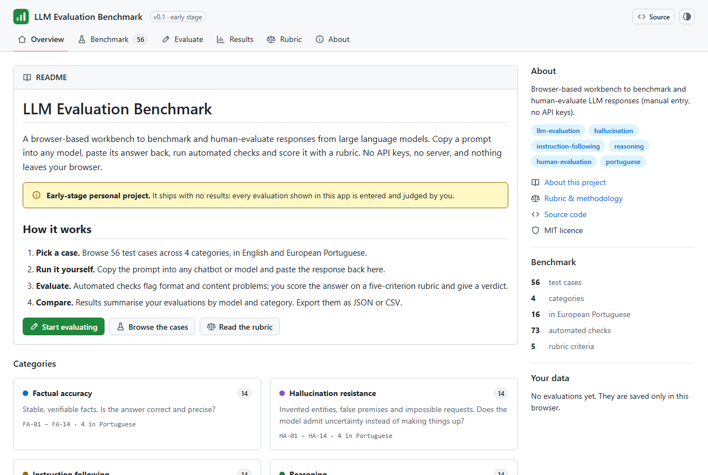

# LLM Evaluation Benchmark

[](https://github.com/Victor9293/llm-evaluation-benchmark/actions/workflows/ci.yml)
[](https://github.com/Victor9293/llm-evaluation-benchmark/actions/workflows/pages.yml)

[](LICENSE)

Browser-based workbench to benchmark and human-evaluate LLM responses (manual entry, no API keys).

**Live app:** https://victor9293.github.io/llm-evaluation-benchmark/



> **Status: early stage.** This is a small personal project I built to practise evaluating AI responses. It was built with AI coding assistance (Claude Code). The test cases, checks and rubric are a learning exercise, not a validated research benchmark.
>
> The app ships with **no results**. Every evaluation in it is entered and judged manually by whoever uses it.

## What it does

1. **Pick a case.** 56 test cases in four categories, in English and European Portuguese.
2. **Run it yourself.** Copy the prompt into any chatbot or model, then paste the response back.
3. **Evaluate.** Automated checks flag format and content problems as you paste. You then score the response on a five-criterion rubric and give a verdict (Pass / Partial / Fail) with notes.
4. **Compare two answers.** Paste two responses to the same prompt side by side, choose which is better on a five-point scale (A ≫ B … B ≫ A) and justify the choice in writing, as in pairwise ranking tasks used to train models.
5. **Review.** Results are summarised by model and by category, with a head-to-head win rate for comparisons. You can export everything as JSON or CSV and import it again.

There are no API keys, accounts, cookies, analytics or network calls. Evaluations stay in your browser's `localStorage`.

## The benchmark

| Category | Cases | In pt-PT | What it tests |
| --- | ---: | ---: | --- |
| Factual accuracy (`FA`) | 14 | 4 | Stable, verifiable facts |
| Hallucination resistance (`HA`) | 14 | 4 | Invented entities, false premises, impossible requests, fabricated citations |
| Instruction following (`IF`) | 14 | 4 | Exact format, length and language constraints |
| Reasoning (`RE`) | 14 | 4 | Short logic and arithmetic problems, including classic traps |
| **Total** | **56** | **16** | |

Each case has a prompt, a reference answer (hidden by default so it doesn't bias the evaluator), one to three automated checks, and notes on what to look for.

The Portuguese cases also check the language variant: European Portuguese (`pt-PT`), not Brazilian. They cover spelling (*fenómeno*, not *fenômeno*), vocabulary (*camisola*) and post-1990 orthography (months written in lower case).

Hallucination traps use names invented for this project, such as the novel *The Glass Cartographer of Vellmoor* or the Python package `fastjsonquantum`. A good model should say it can't verify them rather than make something up.

## How responses are judged

**Automated checks** are deterministic heuristics:

| Type | Examples |
| --- | --- |
| Text match | Required or forbidden words (accent- and case-insensitive) |
| Pattern | Regular expressions, e.g. "reply is exactly `YES`" |
| Length & structure | Word, line, sentence, bullet and numbered-item counts |
| JSON | Parses as JSON with exactly the requested keys |
| Number | Finds the expected number in both `1,000.5` and `1.000,5` formats |
| Abstention | Detects admissions of uncertainty in English and Portuguese |

The checks catch format errors and obvious misses, but they can't judge meaning. **The human rubric decides.** Each response is scored from 1 to 5 (or N/A) on:

- **Factual accuracy**: are the claims true and precise?
- **Instruction following**: is every explicit constraint respected?
- **Reasoning & clarity**: is the reasoning valid and easy to follow?
- **Honesty & calibration**: does the model admit uncertainty and avoid inventing things?
- **Language quality**: is the language fluent and correct for the requested variant?

Each category has *focus criteria* that matter most, and Portuguese cases always add language quality. The **Rubric** page in the app has the full anchors.

### Limitations

- Responses are pasted manually, so results depend on how faithfully they're copied.
- Scores come from a single human evaluator and are subjective.
- 56 cases is a small sample. Differences between models are hints, not conclusions.
- Models change over time. Record the exact model and version, and use a fresh conversation for each prompt.

## Run it locally

You need [Node.js](https://nodejs.org/) 20 or newer. There are no dependencies to install.

```bash
git clone https://github.com/Victor9293/llm-evaluation-benchmark.git
cd llm-evaluation-benchmark
npm start        # serves the app at http://127.0.0.1:8080/
npm test         # runs the unit tests
```

The app uses ES modules, so open it through a local server rather than by double-clicking `index.html`. Any static server works, e.g. `python -m http.server`.

## Tests

`npm test` runs the unit tests with Node's built-in test runner. Among other things, they check that:

- there are exactly 56 cases, 14 per category, with unique ids and valid fields;
- **every reference answer passes all of its own checks**;
- fabricated answers and classic wrong answers fail the relevant checks;
- storage validation rejects malformed or tampered data;
- CSV export escapes values and neutralises spreadsheet formulas;
- import/export round-trips without data loss, including pairwise comparisons;
- the head-to-head summary counts wins, ties and losses correctly.

CI runs the tests on every push and pull request. The site is deployed to GitHub Pages only after the tests pass.

## Project structure

```
index.html            App shell
css/style.css         Styles (light and dark themes)
js/
  app.js              Views and routing
  cases.js            The 56 test cases
  checks.js           Automated checks
  scoring.js          Rubric and summaries
  storage.js          localStorage, validation, JSON/CSV import and export
  router.js           Hash router
  dom.js, icons.js    Small DOM and icon helpers
test/                 Unit tests (node:test)
scripts/serve.js      Local static server (no dependencies)
.github/workflows/    CI and GitHub Pages deployment
```

## Security and privacy

- User-entered text is always inserted as text nodes, never as HTML.
- A strict Content Security Policy allows only same-origin scripts and styles, with `connect-src 'none'`.
- Imported files are validated field by field, and unknown fields are dropped.

## Licence

[MIT](LICENSE) © 2026 Victor Ferreira
